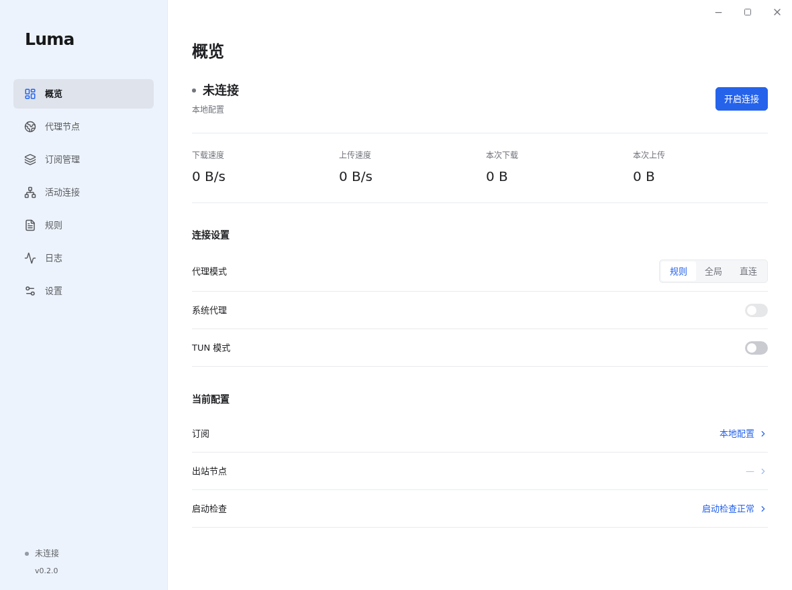

# Luma

Windows 10 / 11 x64 Mihomo client. Pure white content, a wide sidebar, light/dark/system themes and custom colors.



## Download

[GitHub Releases](https://github.com/Nilarf2/luma-proxy/releases) provides an installer and a portable EXE. Both include Mihomo and the optional Windows service helper. They are unsigned. Compare the downloaded file with `SHA256SUMS.txt`.

The installer finish page has a **创建桌面快捷方式** checkbox. Login startup is available in the installed app; the portable edition keeps data in the same user application-data directory and does not register login startup.

## Features

- Import local YAML, subscription URLs, Base64 subscriptions and common SS/Trojan/VLESS/VMess URIs. Edit/export profiles, combine sources, apply global/per-profile YAML or isolated JavaScript, and manage rules, nodes and groups.
- Rule/global/direct modes, selectors, latency tests, provider refresh/health checks, searchable rules, per-connection controls and live logs.
- System proxy with bypass, PAC and ownership-aware recovery. TUN with configurable stack, routes and DNS. IPv6, LAN access and listener ports are configurable.
- Optional protected Windows service for TUN from a normal desktop account. Installation/removal requires an explicit UAC action. Without the service, TUN requires an elevated app.
- Subscription usage/expiry and automatic refresh; local startup diagnostics; tray controls; silent launch, global hotkeys, notifications, network-change reconnect and UWP loopback settings.
- Local/scheduled backups, explicit WebDAV upload/restore, verified app downloads and stable/alpha Mihomo updates.
- Light/dark/system appearance, preset/custom accent and sidebar colors, navigation order/visibility and custom CSS.
- Optional authenticated loopback controller with explicit CORS origins and imported local WebUI; the service controller remains private. Twelve upstream media checks run only after an explicit click, through the running local proxy.

All network tests are user initiated unless an interval is explicitly enabled. Startup diagnostics check the local environment; they do not test nodes, fetch subscriptions or connect automatically. Automatic connection is a separate setting. There is no telemetry.

TUN installation and service controls affect Windows networking. The service runs a fixed protected core, accepts requests only from its installing user and keeps its privileged controller secret private. Local provider files must be explicitly imported as assets. To use a selected or updated desktop core in service mode, explicitly synchronize it from service settings and approve UAC. The helper verifies the confirmed SHA-256, holds the source image against modification, copies it to the protected fixed target and restarts the service with rollback on failure. A digest mismatch blocks connection until synchronized. TLS client certificate/key import reads an explicitly selected pair into profile YAML as inline PEM; the service validates the matching pair and rejects filesystem references. RSA/EC/DSA private keys are supported.

## Configuration

Profiles and settings live under `%APPDATA%/Luma`. Backups contain complete profile configuration, subscription credentials, node secrets and any imported TLS client private keys; store them privately. WebDAV credentials are used for the requested operation and are not saved in settings. HTTPS URLs are recommended.

Composition order is source profiles → selected profile → global YAML → profile YAML → global JavaScript → profile JavaScript → managed runtime networking. Conflicting node/group/provider names across sources fail validation. Source rules precede the selected profile's rules, excluding source catch-all rules. JavaScript receives JSON configuration only, with bounded time and memory and no Node APIs.

See [capability and acceptance checklist](docs/PARITY.md) for known differences from Clash Verge Rev. This version does not establish complete feature parity. The release scope is Windows x64. Interactive UAC behavior remains a manual acceptance item; CI asserts a same-SID Basic User token for the TUN owner, with no administrator fallback. GEOIP/GEOSITE configurations may need first-use data downloads.

## Development

Node.js 24+, .NET 8 SDK and Rust 1.99.1+:

```sh
npm ci
npm test
npm run dev
npm run core:win
dotnet run --project service/tests/Policy.Tests.csproj -c Release
dotnet publish service/Luma.Service.csproj -c Release -r win-x64 --self-contained true -o resources/service
cargo +1.99.1 test --locked --manifest-path media/Cargo.toml
cargo +1.99.1 build --locked --release --manifest-path media/Cargo.toml
# Windows PowerShell: prepare the optional bundled media helper
New-Item -ItemType Directory -Force resources/media
Copy-Item media/target/release/luma-media.exe resources/media/luma-media.exe
npm run dist:win
```

`npm run core:linux` enables the real-core integration test on Linux. `npm run test:ui` runs browser interaction checks; `CHROMIUM_PATH` can select an installed Chromium binary. Windows CI builds the native helper, tests service policy, exercises actual TUN/route/owner-death cleanup using local fixtures, tests the packaged app and proxy recovery, then builds both EXEs. The TUN fixture uses a real restricted owner process and a reserved destination routed into a local HTTP proxy; it does not contact an external target. See [media helper protocol and source provenance](media/README.md). No real subscription or public latency endpoint is used in automated tests.

## License

GPL-3.0-only. See [LICENSE](LICENSE), [third-party notices](THIRD-PARTY-NOTICES.md) and [service architecture](service/README.md).
